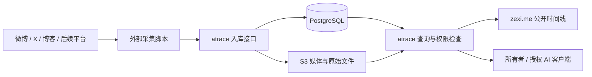

# atrace 产品定义

状态：第一版产品基线，待实现。日期：2026-11-12。

## 1. 产品定位

atrace 是面向个人的数字足迹归档服务，用于解决个人内容分散在不同平台、难以长期保存和统一检索的问题。

它接收外部采集结果，保存内容、行为、来源和历史，提供统一查询能力。全部收录内容构成私人档案；用户可以选择部分内容公开，由 zexi.me 展示为个人主页。

收录不等于发布。是否值得保存，与是否适合公开，是两个不同决策。

## 2. 用户与访问者

第一版只有一位档案所有者，不做多租户。

- 所有者：通过认证查询完整档案，管理可见性。
- 采集程序：使用独立的受限凭据提交采集结果，不拥有公开发布权限。
- AI 客户端：使用受限读取凭据查询授权内容，不默认拥有写入或发布权限。
- 普通访客：通过公开接口或 zexi.me 阅读已公开内容。

第一版只支持 private（仅自己）和 public（公开），不做好友、群组、指定人可见或匿名分享令牌。

## 3. 典型使用场景

1. 将自己在微博、X、博客等平台的内容收录到一个私人档案中。
2. 再次采集相同内容时更新同一记录，不产生重复条目。
3. 按时间、来源、类型和关键词找回曾经发布、收藏、评论或转发过的内容。
4. 选择公开条目，让 zexi.me 自动展示；取消公开后私人档案仍保留。
5. AI 查询“我以前收藏过哪些相关内容”，返回有来源、有时间、有原文证据的结果。
6. 原平台删除内容或账号失效后，仍能访问已保存的档案及媒体。

“看过什么”仅在实际接入浏览／阅读记录后才可查询。收藏、点赞和打开页面不能被推断为读完，也不能被推断为赞同。

## 4. 第一版范围

### 必须提供

- 统一的认证入库接口。
- 永久 ID，独立于正文、标题、目录和平台来源。
- 内容、行为、来源关系及修改历史的持久化。
- 重复提交幂等、来源关联唯一约束、采集批次及错误回执。
- 默认私有；所有者可以显式公开或取消公开。
- 按时间、平台、类型、关键词过滤，以及稳定分页和单条详情。
- 结构化 JSON 读取接口；适合 AI 使用的正文、出处和时间信息。
- PostgreSQL 和 S3 的备份、导出与恢复路径。
- 复用现有微博、X、公开博客采集作为首批接入对象。

### 明确不做

- 点赞、回帖、关注、互动通知、推荐流等本站社交功能。
- 正文编辑器、协同编辑或通用笔记应用。
- 插件市场、第三方插件运行环境。
- 向量数据库、语义检索、内置大模型或自动人生总结。
- 多用户档案、多租户、好友和分组权限。
- 在存储服务里运行平台登录、爬虫或浏览器自动化。
- 第一版同时接入所有平台；小红书和浏览历史等按对接器逐步扩展。

原平台的评论、点赞属于可归档的行为和历史材料；它们不意味着本站提供新的评论区或点赞功能。

## 5. 系统边界

- 对接器：负责平台读取、格式转换、原始证据、媒体获取和平台游标。
- atrace：负责入库校验、身份、幂等、历史、持久化、权限和查询。
- zexi.me：负责公开页面与呈现，继续保持现有轻量阅读体验。
- AI：调用查询接口，基于返回证据回答，不成为数据存储的必要依赖。

独立仓库不意味着拆分大量微服务。初期一个 atrace 服务即可，不引入 Redis、消息队列或独立搜索服务。

## 6. 概念数据模型

以下定义语义，不提前锁定表数量、SQL 字段名或具体 API 路径。

### 内容 Content

一篇文章、一条帖子、一段评论或一个其他可独立引用的内容对象。

保存永久 ID、类型、标题（可空）、正文及其格式、原作者、原始发布时间、首次收录时间、最后同步时间、来源关系和版本。

归档别人的文章不改变作者；所有者收藏了一篇文章，不代表该文章由所有者创作。

### 行为 Activity

所有者与内容之间发生的事件，例如发布、收藏、点赞、转发、评论、浏览。

保存永久 ID、行为类型、发生时间、关联内容、来源及必要的行为说明。取消收藏等变化可记录为后续状态或事件，不删除已有历史。具体事件表达在接口设计时确定。

内容与行为分开：同一篇文章可能先被浏览，后来收藏，再被评论。不为了支持不同事件复制多份正文。

### 来源 Source Reference

保存平台、账号、平台原始 ID、原文链接，与本地永久 ID 的映射。

来源键用于重复同步定位已有条目，不充当网站永久 ID。博客应携带稳定元数据 ID，目录重命名时继续沿用。

相同正文不能直接证明是同一内容。跨平台合并应保留所有来源；有歧义时不自动合并或覆盖。

### 版本 Revision

保存正文和相关元数据的变化、采集时间、内容哈希及原始证据对象键。

内容哈希用于判断有无变化，不用于分配永久身份。未变化的重复采集不新增内容版本。

### 附件 Asset

保存 S3 对象键、媒体类型、尺寸、大小、校验值及与内容的关系。使用稳定对象键，不将临时签名 URL 当作永久地址。

引用、转发和媒体保留结构，不只拼接成一大段文字。合理使用 JSONB 保存有层级的引用和平台扩展字段，但可查询的核心字段应有稳定语义。

### 同步批次 Ingest Run

记录来源、幂等键、进度、数量、错误、开始与完成时间；支持重试、核对和故障定位。

## 7. 身份、同步与公开规则

1. ID 首次分配后永久保存，不随内容或来源变化；删除／撤下后不回收。现有 zexi.me 链接原样保留。
2. 新 ID 的字符集和长度在接口设计阶段确定；无论长度如何，都必须使用唯一约束和碰撞重试，不把短 ID 当作访问凭据。
3. 同一平台账号与原始 ID 对应已有内容；明确的来源变更通过关联迁移处理，不靠正文相似度猜测。
4. 每个入库请求携带幂等键。媒体保存完成并经校验后，数据库才引用它；部分失败不得伪装成整批成功。
5. 游标在对应批次成功核对后推进。某次没抓到内容不视为删除，原站删除与本地永久清除是不同操作。
6. 新内容默认私有，采集器不得扩大可见范围。
7. 公开针对明确的内容版本。公开条目采集到新版本时，旧公开版本保持不变，新增版本等待确认，避免自动公开后续私密修改。
8. 公开一条行为不自动公开其关联私有内容；引用、附件和关联字段需要明确的公开投影，不能递归泄漏私有档案。
9. 取消公开须同时作用于详情、列表、搜索、附件、AI 接口与受控缓存。已被访客下载的副本无法撤回。

## 8. 查询与权限

同一套权限规则用于网页、JSON、正文导出和 AI 查询。未经认证只返回公开版本；所有者身份可读私人档案；采集和 AI 凭据按最小能力分离。

查询结果至少包含稳定 ID、正文、原作者、事件／发布时间、来源链接和本地永久引用地址。时间缺失或内容不完整应明确标记，不补造事实。

第一版使用普通关键词查询，不需要向量库。具体中文匹配实现通过样本验证选择，不因选用 PG 就假定中文分词已经解决。

S3 私有文件不可通过公开 bucket 路径绕过权限。对外文件读取必须经过认证路由或有期限的授权访问；公开与私有媒体的策略需要专门验证。

## 9. 存储与可维护性

- 复用现有集群 PG，使用独立数据库和专用非超级用户角色。
- 复用集群 S3，明确隔离私人档案与现有公开网站对象。
- 原始采集材料保留，统一内容可以追溯来源；备份同时覆盖数据库和文件。
- 数据库迁移纳入仓库管理；提供可读、可迁移的导出格式，不依赖特定前端。
- 凭据不进入仓库或日志；记录足够的批次状态即可，不默认把私人正文写入日志。
- 不深度 fork Memos。可参考其接口与权限经验，但 atrace 的模型围绕归档与同步定义。

## 10. 渐进实施

1. 定义入库／查询契约与最小数据库结构，用测试样本验证身份、幂等和版本。
2. 接入现有公开快照，原样保留所有公开 ID、来源、排序和正文；在隔离环境对比。
3. 将现有采集输出接到 atrace，先验证私有收录与公开选择，保留旧管道作为迁移期回滚路径。
4. zexi.me 切换为读取 atrace 的公开接口，保留现有链接和阅读交互。
5. 接入只读 AI 客户端，再逐步增加收藏、评论、点赞及新平台来源。

迁移存量公开内容时保持其原有公开状态；后续新采集内容默认私有。公开筛选不再决定是否收录到私人档案。

## 11. 第一版验收标准

- 同一批数据重复导入两次，没有重复内容或无意义的新版本。
- 正文更新保留同一 ID，旧版本仍可追溯；修改博客目录不改变身份。
- 新记录默认私有；未认证访问正文、附件、搜索和 AI 接口均不能获取它。
- 所有者公开指定版本后，公开查询与主页能看到；取消公开后不能再从受控入口读取。
- 已有公开链接继续有效；来源与作者信息不丢失。
- 中断后可以安全重试；部分失败不会清空或删除已有档案。
- 通过一组真实样本验证关键词、日期、来源及行为查询。
- 能从备份恢复数据库与对应附件，并核对记录数、ID 和文件校验值。

## 12. 尚待实现阶段决定

- API 的具体路径、分页协议、字段格式和凭据方式。
- 新 ID 长度以及旧链接别名的存储方式。
- 原始证据的保留周期及所有者主动永久清除流程。
- 公开管理入口的最小交互（只切换可见性，不提供正文编辑器）。

上述实现细节不改变产品范围，也不构成现在迁移或发布线上服务的声明。
